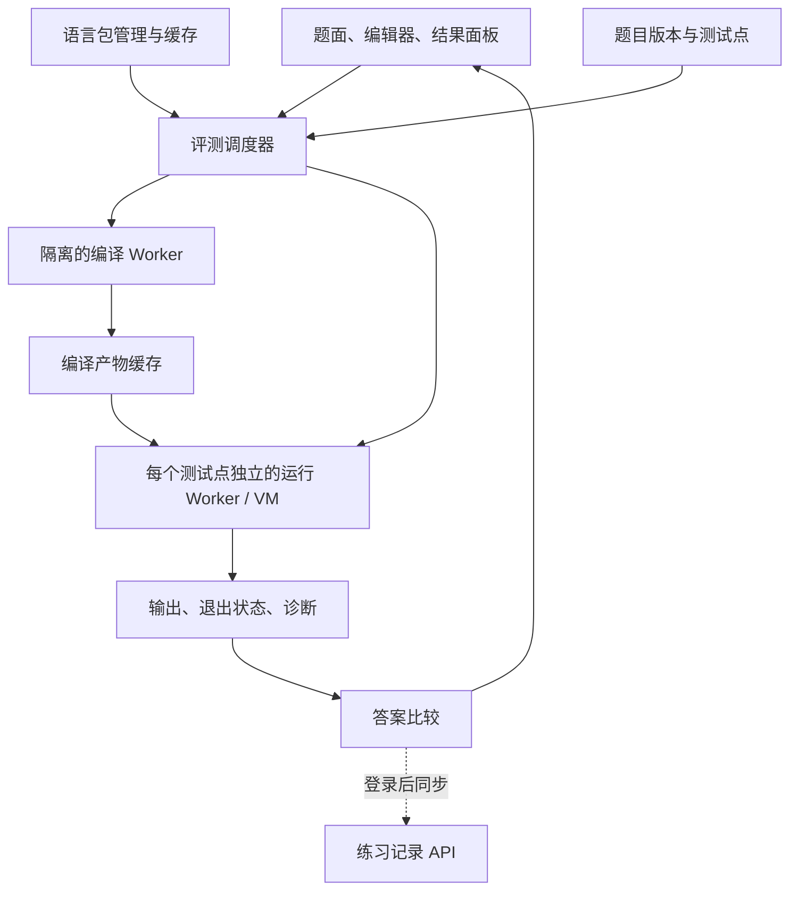

# 浏览器端编程评测实施计划

状态：本地实现进行中。C11、C++17、Python 3.11、Java 21、Java 8 已在浏览器原型中实际编译／执行并通过验收。Java 8 的编译期为真实 JDK 8 API（ECJ -1.8 + rt.jar），运行期复用已验证的 JDK 21 运行时，UI 如实标注。本计划覆盖语言包分发、浏览器评测、基础题库和前端部署迁移。

## 本地预览（2026-10-17 实测）

| 项 | 值 |
| --- | --- |
| 启动 | `pnpm learning:prepare` 后 `pnpm learning:dev` |
| UI | `http://127.0.0.1:4324/learn`（必须用 127.0.0.1） |
| 管理 | `http://127.0.0.1:4324/admin/learn`，测试管理员 00000000000 / LocalLearning123! |
| 运行器 | `http://localhost:4334`（不同 hostname，登录 Cookie 不覆盖） |
| 数据 | `.local/learning/data/learning.db`（gitignore，独立于生产库） |
| API | `app.learning_dev:app`，仅 `SGU_LEARN_LOCAL=1` 时挂载 `/api/learning` |
| 包体积 | C/C++ ≈16.4 MiB；Python ≈11.3 MiB；Java 21 ≈57.4 MiB；Java 8 ≈79 MiB（与 Java 21 共享同一套运行时，增量 ≈21 MiB） |

已验证：五种语言环境 A+B 全点通过（含 Java 21、Java 8）；WA／RE／TLE／OLE／CE 判定正确；取消后同引擎可恢复执行；SHA-256 校验失败清理半成品缓存且旧版本仍可用；Java 环境按内容哈希共享 ~300MB 运行时对象，双版本独立安装/删除；每测试点独立 Worker（Java 为独立 VM）；登录后记录同步且标记 `client`；390px 无横向溢出；管理页流程通过；生产构建中 `/learn` 输出为 404 重定向页。

Java 实测进展：B-JVM WASM 构建成功并补齐了 natives（realpath0、UnixFileDispatcherImpl 读写、UnixFileSystem.list0、FileOutputStream.open0、NativeImageBuffer.getNativeMap、access0 errno 语义、FIONREAD 兼容、Unsafe.getChar、ffi_set_stdin）。端到端已在浏览器里跑通：ECJ 在 VM 内编译源码 → Main.class 执行 → Scanner/BigInteger/BufferedReader/TreeMap/BitSet/PriorityQueue/Stream 均正确。

- **Java 21**：真实 JDK 21 类库 + ECJ 编译 + B-JVM 执行，A+B 通过。
- **Java 8**：编译期用真实 JDK 8 rt.jar（ECJ -1.8，API 面为 Java 8，不含 `List.of` 等后续 API），运行期复用已验证的 JDK 21 运行时；语义差异极小，文档与 UI 会如实标注。JDK 8 类库直接启动需要为 `sun.misc.*` 补一整套 natives（B-JVM 只实现 `jdk.internal.*` 命名），暂不做。
- 需要打的 JDK 补丁：`SimpleConsoleLogger`（跳过未实现的 StackWalker）、`JRELocaleProviderAdapter`（容忍模块层 ServiceLoader 缺失），均按 `--patch-module` 编译后写回扁平 jar。`java.locale.providers=JRE` 固定基础 locale 数据。

## 导航

- [产品范围与已确定决策](#产品范围与已确定决策)：首版支持范围、Java 版本选择。
- [当前代码与调研依据](#当前代码与调研依据)：接入位置和候选工具链。
- [语言包与下载体积](#语言包与下载体积)：独立安装、Brotli、体积测量口径。
- [Java 兼容性验收](#java-兼容性验收)：Java 8、Java 21 的发布条件。
- [评测架构与执行隔离](#评测架构与执行隔离)：Worker、状态机、结果与限制。
- [题库与页面接入](#题库与页面接入)：出题、练习、进度与管理。
- [服务器与 CDN 迁移](#服务器与-cdn-迁移)：缓存、路由、发布与回滚。
- [实施阶段与完成条件](#实施阶段与完成条件)：顺序、交付物和验证要求。

## 产品范围与已确定决策

新增面向语言基础教学的编程练习。用户选择语言，首次下载对应环境后，在浏览器内编译、运行并比较测试点答案。服务器负责题库、静态运行包和练习记录。

| 项目 | 决策 |
| --- | --- |
| 首版语言 | C、C++、Python、Java 8、Java 21 |
| C/C++ 工具链 | 参考本机 OJ++ 的 YoWASP Clang 22 实现；初始验收 C11、C++17 |
| Java 完整性 | 优先完整 JDK/JVM 路线，至少覆盖算法竞赛所需语法、标准库和运行行为 |
| Java 下载 | `java8`、`java21` 分成独立环境包，用户按需选择和安装 |
| 资源压缩 | Brotli，发布构建默认比较 quality 11 的产物 |
| 部署 | 整站前端迁出 Cloudflare Pages，服务器承载，CDN 分发 |
| 评测位置 | 编译、执行、答案比较在客户端完成 |
| 首版题型 | 单文件源码、批量标准输入输出；一个源码文件可包含多个类 |
| 当前交付 | 本地预览：运行器、题库、练习与管理页已可用（见上方实测表）；Java 未达标，部署迁移未实施 |

进入题目时只检查所选环境。选择 Java 8 时下载 Java 8，切换到 Java 21 后再提示下载 Java 21。C/C++ 共用已校验的编译器和标准库资源。题目、测试数据、编辑器和语言包分别更新。

单版本下载预算使用 `max(Java8 完整包, Java21 完整包)`；CDN 容量按实际保留的版本累加。包管理页面分别展示每个环境的下载大小、安装占用、版本和删除入口。前期讨论的 64 MiB 是临时容量预留，后续以各版本可运行产物的测量值替换。

## 当前代码与调研依据

现有前端使用 Astro 静态输出和 Vue，后端为相邻仓库中的 FastAPI。接入时需复用现有 API、认证和 UI 控件：

| 已有位置 | 实施时的关系 |
| --- | --- |
| [astro.config.mjs](../astro.config.mjs) | 保留静态输出，增加运行器资源的独立构建与本地代理配置 |
| [src/lib/api.ts](../src/lib/api.ts) | 接入题目、题目版本和练习记录接口 |
| [src/lib/auth.ts](../src/lib/auth.ts) | 登录后同步本人记录；匿名用户可本地练习 |
| [public/sw.js](../public/sw.js) | 当前承担 Web Push；新增缓存能力时保留推送行为 |
| [deploy/sgu-acw.zh314.xyz.conf](../deploy/sgu-acw.zh314.xyz.conf) | 源站配置：API 同源代理、文章壳重写、RSS 转发、旧链接 301 |
| [deploy/migrate-to-server.sh](../deploy/migrate-to-server.sh) | 发布静态产物 + 安装站点配置 |
| [public/_redirects](../public/_redirects) | 保留已有旧地址跳转 |
| [.github/workflows/cloudflare-pages.yml](../.github/workflows/cloudflare-pages.yml) | 校验步骤保留，发布目标改为服务器版本目录 |
| [AGENTS.md](../AGENTS.md) | 新页面沿用管理区、44px 控件和手机布局规则 |

### 候选工具链

- C/C++：本机相邻仓库 `OJ-Plus-Plus` 提交 `0ed00b3` 已使用 `@yowasp/clang 22.0.0-git20542-10`。参考 `src/extension/runner.worker.ts`、`src/extension/offscreen.ts`、`tools/build-extension.mjs` 和 `tools/runtime-assets.json`。GitHub 旧版本中的 Clang 8 不能作为当前选型依据。
- Python：参考 OJ++ 的 CPython/WASI 路线和标准输入输出适配。调研样本使用 CPython 3.11.3；正式发布前固定版本并执行兼容性回归。
- Java：优先验证 [B-JVM](https://github.com/anematode/b-jvm) 与真实 JDK 类库、编译器的组合。仓库包含 Java Compiler API 编译并加载新类的测试，但尚未验证本站要求的 Java 8、Java 21 环境。其 JDK 23 支持说明不能替代这两个版本的验证。
- [TeaVM javac](https://github.com/konsoletyper/teavm-javac) 的浏览器编译执行已用小程序验证，集合、排序和 `BigInteger` 可运行；当前发布包缺少 `Scanner` 和 `System.setIn`，暂不作为默认实现。
- [CheerpJ](https://cheerpj.com/docs/licensing.html) 作为备选调研。自托管需要商业许可，并须重新核对两个目标 Java 版本的支持情况。

Java 的选型结论应包含可运行构建、兼容测试和资源测量。仅有项目介绍或编译器演示不足以确认支持。

## 语言包与下载体积

### 包划分与缓存

拟设 `c-cpp`、`python`、`java8`、`java21` 环境标识。语言下拉框区分 C/C++，底层共享同一个工具链包。Java 8 与 Java 21 分别包含匹配的编译器、类库、JVM 和加载代码；跨版本共享文件需先证明兼容，并按内容摘要复用。

运行包清单需记录环境标识、发行版本、编译器和类库版本、浏览器能力要求、文件 URL、传输体积、解码后大小、SHA-256、解包后的空间上限及许可证。Java 完整下载大小计入该环境的全部依赖。

默认通过 `Content-Encoding: br` 分发预压缩资源，浏览器原生解压。WASM 响应保留 `Content-Type: application/wasm`，响应缓存正确区分编码。清单中的完整性校验针对 `fetch` 返回的解码后字节；传输体积单独记录，不能拿压缩文件的摘要校验解码后的内容。采用此方式后，运行器不再把同一响应交给 zstd 解压器。

HTTP 缓存和应用安装占用分别测量。`fetch` 得到的解码后资源写入 Cache API，并不等于只占用 Brotli 文件大小。下载前使用 Storage API 检查空间，处理配额不足、浏览器回收缓存和私密浏览模式。

安装流程为 `未安装 → 下载 → 校验 → 安装完成`；失败、取消返回可重试状态。所有必需资源成功后才激活新版本，失败期间旧版本继续可用。多标签页协调同一版本的安装；资源按不可变 URL 发布，运行中的任务固定使用开始时的版本。

已安装环境支持离线执行已缓存的题目和测试数据。题库离线范围单独展示，完整站点离线能力后续扩展。

### 已测体积

以下为同一台开发机使用 Brotli 1.2.0、quality 11 的结果。Java 项目是资源体积探针，尚未组成可运行的浏览器发行包。

| 资源 | 测量内容 | Brotli 大小 |
| --- | --- | ---: |
| Clang 22 主体 | OJ++ 的核心 WASM 与标准库归档，原始合计约 100.3 MiB | 17,121,227 B，约 16.33 MiB |
| Java 8 类库与编译器 | Corretto 8.504.04.1 的全部 JRE 库 JAR、附属库及 `tools.jar` | 22,536,240 B，约 21.49 MiB |
| Java 21 类库与编译器 | Temurin 21.0.11 的全部 69 个 jmod 中的类与资源，包含编译器 | 28,528,305 B，约 27.21 MiB |
| Java 21 模块镜像 | 同一 JDK 的 `lib/modules` | 28,230,944 B，约 26.92 MiB |

Java 8 测量时将 JAR 条目改为 ZIP_STORED，再对外层归档做 Brotli，避免对已 deflate 的 JAR 直接重复压缩。Java 21 类路径探针保留模块描述符及冲突资源的独立条目。这些重打包方式只验证体积与内容保留，仍需验证运行器的实际加载方式。

各压缩文件均通过解压后的 SHA-256 比较。Java 表内未计 WASM JVM、浏览器加载器和运行时额外必需文件；Clang 行也未计 JS 加载器和少量小文件。

类库与编译器主体的单版本最大值为 `max(21.49, 27.21) = 27.21 MiB`。当前 B-JVM 加载器读取类路径 JAR 和模块镜像；如直接沿用这一布局，Java 21 对应资源为 `27.21 + 26.92 = 54.13 MiB`，再加 JVM 等开销。这是同一 Java 版本内的重复表示，与 Java 8、Java 21 分开下载无关。去重需要验证加载器，不能提前算成已实现的体积收益。

正式发布清单应替换上述探针数字，分别报告各环境的 CDN 实际传输字节、安装占用、首次可编译时间、热启动时间及执行内存表现。

## Java 兼容性验收

Java 8 和 Java 21 使用各自版本的编译器、API 与运行语义。Java 21 的 `--release 8` 编译模式不能单独充当 Java 8 环境。完整性优先于压缩收益，标准库裁剪须经过竞赛兼容性评估。

| 范围 | 首版验收内容 |
| --- | --- |
| 源码组织 | `public class Main`、主方法、单文件多类、包内类、内部类、匿名类、静态初始化 |
| 语言特性 | 泛型、装箱拆箱、枚举、异常、Lambda、方法引用；Java 21 额外覆盖 record、switch 表达式等已正式发布特性 |
| 输入输出 | `Scanner`、`BufferedReader`、`InputStreamReader`、`StringTokenizer`、自定义字节快读、`PrintWriter`、缓冲字节输出 |
| 输入边界 | EOF、空输入、CRLF、负数、连续空白、大输入、UTF-8、无末尾换行 |
| 容器与算法 | `ArrayList`、`ArrayDeque`、`PriorityQueue`、各类 Map/Set、`BitSet`、`Arrays`、`Collections`、比较器、二分、排序 |
| 数值与字符串 | `BigInteger`、`BigDecimal`、`Math`、`StrictMath`、`StringBuilder`、正则、字符编码 |
| 执行语义 | 溢出、移位、取模、转换、浮点、数组越界、空指针、对象比较、反射及标准类加载路径 |
| 其他常见 API | Stream、标准随机数的固定种子行为、用于模板的序列化及虚拟文件读写 |
| 资源与恢复 | 递归、堆内存、异常堆栈、多次运行、静态变量隔离、超时和取消后恢复 |

使用对应版本 OpenJDK 作为参照，对有确定行为的程序做差分验证。测试不能依赖未规定的容器遍历顺序或竞态结果。维护常用算法模板、固定边界用例和带种子的随机用例，覆盖图、树、字符串、大整数和大数据输入输出。

两个版本分别记录兼容性缺陷、支持的资源上限和浏览器范围。缺失常见快读、标准容器或数值行为时，该版本不能标记为可用。完整类库文件的存在不能代替执行测试。

宿主文件、GUI、系统进程和任意网络访问不属于首版竞赛能力；文件 API 使用任务私有的虚拟文件系统。线程相关 API、Stream 并行操作及虚拟线程的支持程度在选型时核实并公开记录，不能用基础语法测试推断完整 Java 平台兼容性。

## 评测架构与执行隔离



源码、输入和环境版本在评测开始时形成快照。C/C++ 编译一次生成 WASM，Java 编译一次生成 class 或 JAR，Python 交给解释器。调度接口允许不同产物类型。

编译缓存以源码摘要、环境版本、编译参数和相关资源版本为键。每个测试点使用新实例或新 VM、私有文件系统和新的输入流，避免全局变量、静态字段、未关闭文件影响下一点。大资源可复用已校验字节，不能复用上次程序的可变状态。

下载、初始化、编译、执行和答案比较分别展示状态。编译计时与运行计时分开；超时由执行 Worker 外的可信调度器终止，不能依赖待测程序主动响应。限制源码、输入、总评测时间、输出和缓存容量，具体阈值由设备实测确定。

任务使用唯一 ID 过滤迟到响应。取消、切换题目或重新评测后，旧结果不能覆盖当前页面；一个页面同时只运行一个评测任务。后台冻结、页面卸载和浏览器终止任务要报告为中断或环境错误，避免误报 WA。

结果包括 AC、WA、编译错误、运行错误、超时、输出超限、取消和环境错误。只有能可靠识别的内存超限才报告 MLE；无法测得的内存不展示为 0。耗时用于本机反馈，不作为跨设备排名依据。

### 运行边界

Worker 负责线程隔离，WASM 通过受控 imports 和虚拟文件系统取得能力。编译器及加载代码也需隔离，不能只审查最终程序。

运行器放在没有本站登录凭据的独立 origin，且不受会话 Cookie 的 Domain 范围覆盖。宿主只发送源码、输入、运行资源和任务配置。跨窗口消息校验来源、发送窗口、任务 ID 和消息结构；CSP 限制脚本、网络和子 Worker 来源。运行程序不取得站点 API、Cookie、令牌和宿主存储接口。

验证死循环、无限输出、内存增长、伪造消息、访问宿主 API 和跨任务读取数据。需要共享内存或其他高级能力时先单独验证部署条件，避免默认改变全站跨源隔离策略。

### 答案比较与记录可信度

首版提供逐字比较和忽略空白的 token 比较，由出题者选择；浮点题增加明确的绝对／相对误差规则后再发布。比较规则属于题目版本。

参考答案保留在调度层，不放进程序的虚拟文件系统。纯客户端的测试点和结果可被用户检查或修改，登录后同步的记录标为客户端评测。基础练习进度独立于现有平台刷题榜和集训成绩。需要正式考试成绩时另设可信复评流程。

## 题库与页面接入

建议新增 `/learn`、`/learn/problem?id=...`、`/learn/runtimes` 和 `/admin/learn`。现有 `/practice` 是平台练习数据页面，继续承担当前职责。编辑器按需加载，初始建议 CodeMirror 6，提供高亮、缩进和草稿保存。

公共页面提供章节题单、题目描述、样例、语言／版本选择、运行样例、自定义输入和全部评测。窄屏用有文字的面板切换，390px 不整体横向溢出。错误反馈保留源码和输入，允许用户修正后再次评测。

管理页面统一进入管理工作台。新建按钮放内容标题旁，复用 Button、Input、IconButton、ActionNotice 和 RefreshButton。出题流程为草稿、验证、发布；至少使用适用语言的参考解和错误解检查测试数据，浏览器端性能验证与服务器上的参考 JDK 测试分开记录。

后端拟新增本地题目、不可变题目版本、测试数据版本和本人练习记录。题目版本包含题面、样例、可选环境、输入输出约定、比较规则及资源配置；修改测试点或比较规则产生新版本。提交记录固定源码、题目版本、环境版本和结果来源。

现有题单模型主要引用外部平台题号。本地题目先采用独立身份，题单关联在明确的数据模型中增加，避免伪造外部平台或把本地结果混进同步成绩。

题目和测试数据通过只读版本接口分发；管理接口鉴权，个人记录绑定登录用户。记录写入以同一次评测的 ID 去重，同 ID 改源码或环境版本需拒绝，网络重试不重复新增。删除用户时清理关联的练习记录。默认草稿保存在本机；源码上传与代码同步策略在页面中明确，切换语言或刷新不清空正在编辑的内容。

## 服务器与 CDN 迁移

```text
浏览器 → CDN → 服务器 Nginx
                   ├─ 前端静态版本目录
                   ├─ 不可变语言包与清单
                   └─ /api → 现有 FastAPI
```

保持站点域名，保留登录 Cookie、WebAuthn RP ID／origin 和现有 URL。先在测试域名验证，再切换正式入口。运行器独立 origin 的消息与缓存策略也要在测试环境验证。

| 路径或资源 | 迁移要求 |
| --- | --- |
| `/api/*` | 同源代理；保留多条 Set-Cookie、请求方法、响应码、查询串和源站认证；绕过共享缓存 |
| `/post/{slug}` | 返回现有文章静态壳，地址栏保留 slug |
| `/blog/rss.xml` | 代理实时 RSS，采用单独的短缓存策略 |
| 旧链接 | 转移 `_redirects` 中的跳转并验收中文／编码路径 |
| 带内容摘要的 JS、CSS、运行包 | 浏览器和 CDN 长期缓存，按版本保留 |
| HTML、运行包清单 | 短缓存或重新验证，更新时只清理相应入口 |
| Worker、WASM、Brotli 资源 | 验证 MIME、Content-Encoding、CORS、CSP 和缓存命中 |

使用预压缩文件分发；验证 CDN 边缘实际返回的编码和传输字节，避免只检查源站文件大小。重点测客户端到 CDN 的下载速度、缓存命中后的重复流量及首次可执行时间。

前端构建发布到新的 release 目录，检查成功后原子切换 current 指向。语言包独立管理，保留运行中版本和回滚所需资源；清理任务不能删除被引用的环境。迁移验收通过后再替换 Pages 发布流程，保留可操作的回滚路径。

## 实施阶段与完成条件

| 阶段 | 交付物 | 完成条件 |
| --- | --- | --- |
| 工具链验证 | C/C++、Python、Java 8、Java 21 的独立浏览器原型；Java 运行时选型记录 | 各环境实际编译／执行；Java 兼容矩阵通过，记录失败项与性能；四种语言均能进入下一阶段 |
| 环境包发布 | Brotli 构建、版本清单、服务器／CDN 测试分发、下载缓存和包管理 | Java 8、21 独立下载和删除；摘要校验、取消、空间不足、缓存回收、更新失败及多标签页竞争可恢复；报告完整体积 |
| 评测调度 | 编译／运行接口、Worker 隔离、比较器、任务状态和诊断 | 一次编译、多点隔离；迟到响应、死循环、输出超限、取消及异常后的下次执行测试通过 |
| 练习与出题 | 5～10 道基础题、题面／编辑器、章节、发布版本和管理入口 | 管理员能验证并发布题目，访客能选择环境完成评测，登录用户能同步带来源标记的记录 |
| 迁移与试用 | 正式部署迁移、浏览器报告、回滚说明 | 旧功能回归通过；桌面 Chrome/Edge、Firefox、Safari 与手机实测；正常网络和限速条件下记录首次下载、热启动、安装空间及可观测内存 |

Java 8 与 Java 21 都是首版交付条件。候选 JVM 未通过竞赛兼容验证时，继续处理运行时适配或备选选型，题库和页面开发不能掩盖这一缺口。

最终验收还需覆盖运行包发布／回滚、题目版本更新、旧草稿保留、推送通知、登录、文章路由、RSS 和现有题单功能。文档变更本身只做链接、结构和差异检查；实现阶段按所改模块运行前后端检查与浏览器验证。

尚待验证的事项集中在 Java 8／21 的 JVM 和 JDK 适配、重复资源能否去除、浏览器支持范围及手机可承受的资源上限。环境清单和兼容报告明确后，再确定默认时限、内存配置和最终下载文案。
